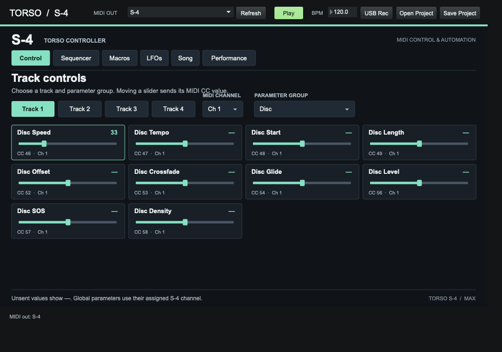
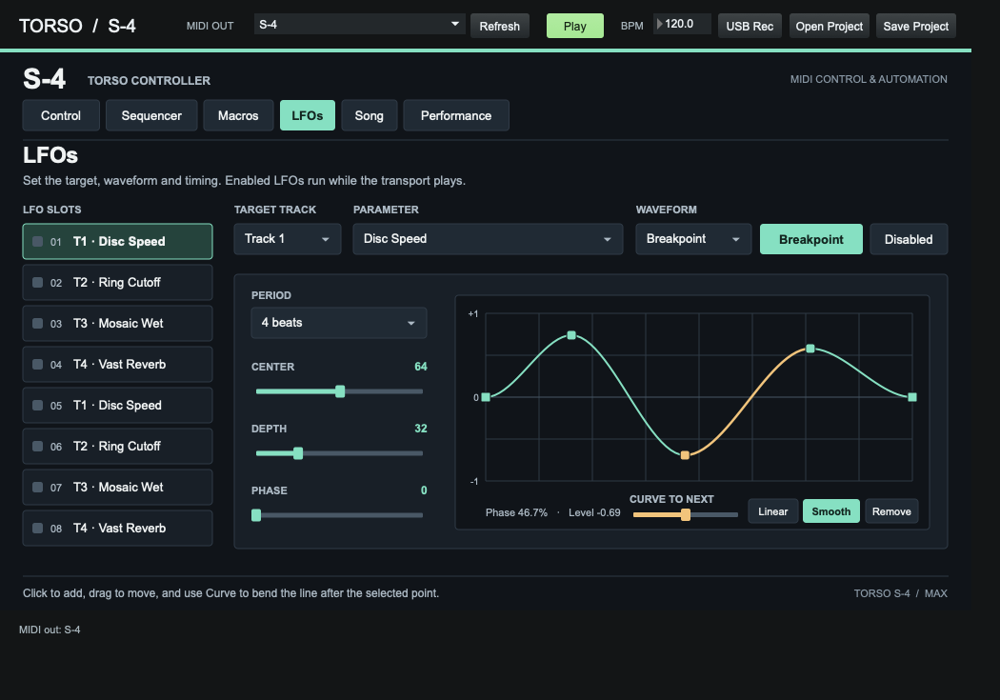
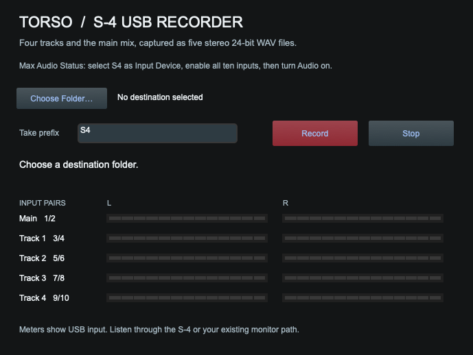

# Torso S-4 for Max

A standalone Cycling ’74 Max 9 controller for the Torso S-4. Send MIDI CCs to the hardware, sequence and modulate parameters, and record the four stereo tracks plus the stereo main mix over USB. Keep the files in this directory together. Max provides the JavaScript and Node runtimes.

## Get started

1. Open [Torso S4 Max.maxpat](Torso%20S4%20Max.maxpat) in Max 9.
2. Connect the S-4 using a USB-C data cable in **Device** mode. For MIDI control alone, you can also connect a MIDI interface to the S-4 MIDI input.
3. On the S-4, turn on **CONFIG → MIDI → CC CONTROL**. Choose the S-4 or your interface under **MIDI OUT** in Max. If you connected the device after opening the patch, click **Refresh** and select it again.
4. Under **Control**, match each track’s MIDI channel to its channel on the S-4. The patch starts with channels 1–4. Perform controls use channel 15 and Mix controls use channel 16.
5. Pick the material that’s active on the S-4 track and move a slider. Some materials and modulator types share CC numbers. The type active on the hardware determines which control responds.

## Controls and automation

| Tab | Use |
| --- | --- |
| Control | Select a track and a parameter group. Sliders send MIDI CC values from 0 to 127. |
| Sequencer | Select a lane and target, then drag across the grid to enter values. Each of the eight lanes supports up to 64 steps, an independent rate, and forward, reverse, or ping-pong playback. |
| Macros | Map up to four targets per macro with independent low and high values. Reverse the endpoints to invert a target. Each macro starts with its corresponding S-4 Perform macro in the first slot. |
| LFOs | Enable a slot, choose a target and waveform, and set its period in beats. Center, depth, and phase set its range and starting point. |
| Song | Enable Song, set a loop length in beats, and add points to a lane. Values interpolate between points. |
| Performance | Drag in the XY pad. Assign up to four targets, each following either axis. |

**Play** starts the sequencer, LFOs, and Song together from beat one on Max’s clock. Start sample playback on the S-4 separately. If two active lanes write to the same parameter, both will send values, so give them different targets when you want independent movement.

To draw a repeating waveform, click **Breakpoint** in **LFOs**. Click the graph to add a point and drag it to move it. Select a point and use **Curve to next** to shape the following segment. **Smooth** eases into and out of that segment. **Linear** straightens it. Match the first and last point’s height for a continuous loop.

**Save Project** writes track settings, patterns, and mappings to a JSON file. **Open Project** restores them with playback stopped. Select your MIDI destination in each Max session.

## Record USB audio

1. Connect the S-4 in **Device** mode. In Max, open **Options → Audio Status**, choose the S-4 as the input device, and set the sample rate to **48 kHz**. Map Max’s logical inputs 1–10 to the corresponding hardware inputs and turn on audio.
2. Click **USB Rec** or open [S4 USB Recorder.maxpat](S4%20USB%20Recorder.maxpat). Check the meters while the S-4 plays.
3. Click **Choose Folder**, optionally enter a take prefix, then click **Record**. Click **Stop** and wait for **Saved five stereo WAVs** before closing the recorder.

| S-4 signal | Max input pair |
| --- | --- |
| Main mix | 1/2 |
| Track 1 | 3/4 |
| Track 2 | 5/6 |
| Track 3 | 7/8 |
| Track 4 | 9/10 |

Max records the ten input channels in one pass, then writes five sample-aligned stereo 24-bit WAVs with the same take name. The temporary ten-channel WAV stays in the destination if splitting fails. Listen through the S-4 or your existing monitor path.

If Max lists ten inputs but the meters stay flat, first check that the S-4 is audible at its own output and that Max has **Privacy & Security → Microphone** access in macOS. You can also select the S-4 temporarily under **System Settings → Sound → Input** and watch the input level during playback. If that meter is flat too, check the S-4 USB connection and device routing before recording another take.

## Source and compatibility

The two `.maxpat` files are editable Max patches. `s4-core.js`, `s4-automation.js`, and `s4-parameters.js` hold the controller state, automation, and MIDI map. `s4-max.js` and `s4-ui.js` connect the controller to Max. `s4-recorder.js` manages recording and `s4-split-wav.js` writes the stereo files with Max’s built-in Node for Max runtime.

The MIDI map follows Torso’s published CC reference. The Swift controller’s Blocks, knob recording, and Spatial Field views are outside this Max port.

[Torso S-4 MIDI reference](https://docs.torsoelectronics.com/s4/appendix/cc-mapping-and-midi-note-reference/) · [USB and MIDI connection guide](https://docs.torsoelectronics.com/s4/midi-and-analog-sync/midi-connectivity/) · [USB audio routing](https://docs.torsoelectronics.com/s4/miscellaneous/usb-audio-interface/)
